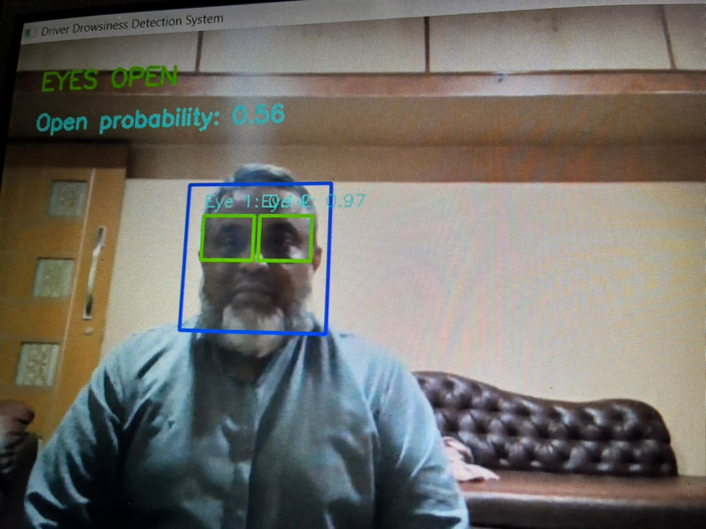
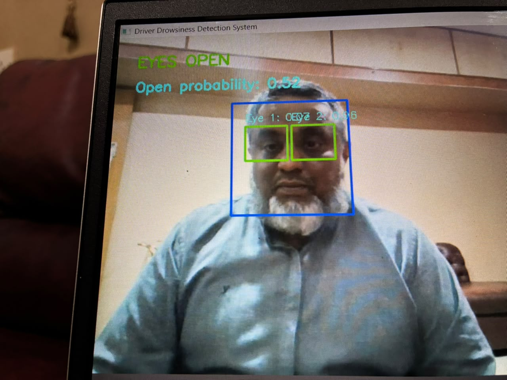
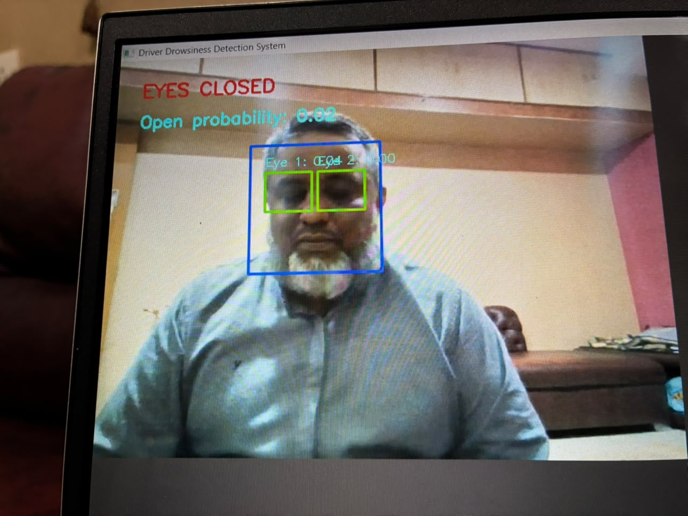
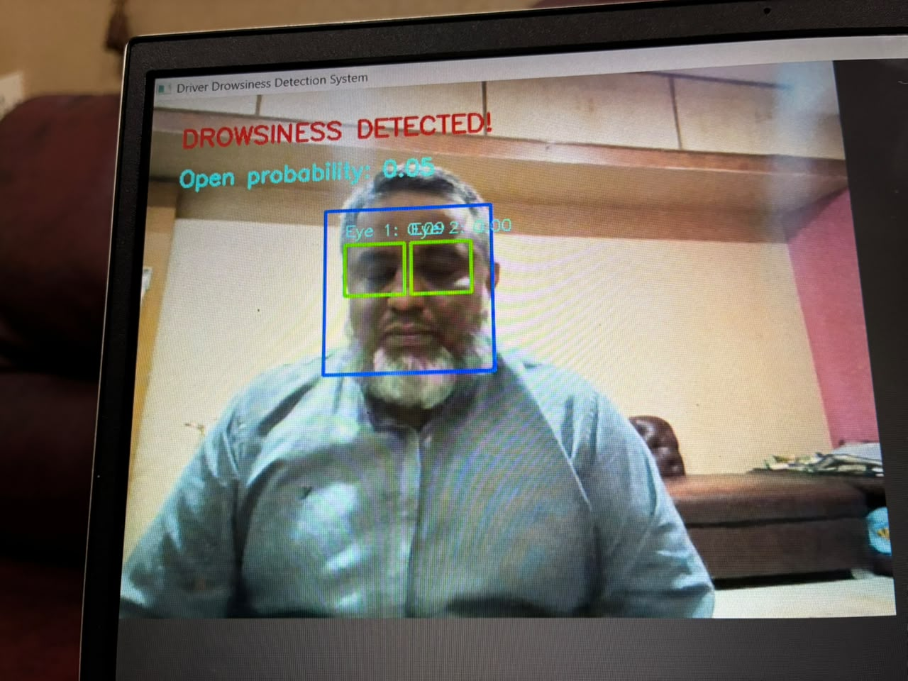
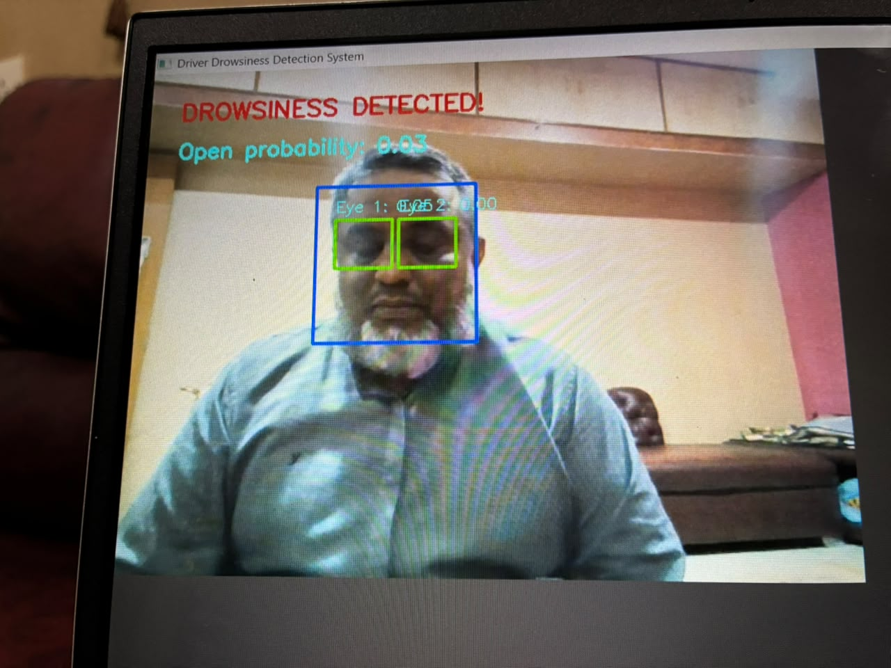

# Real-Time Driver Drowsiness Detection and Alert System Using Deep Learning

## 1. Project Overview

Driver fatigue and drowsiness are major causes of road accidents. This project aims to detect signs of driver drowsiness in real time using a webcam and a deep learning model.

The system monitors the driver's eyes and triggers an audible alarm when prolonged eye closure is detected.

## 2. Objectives

- Detect the driver's face using a webcam.
- Monitor eye states using a trained deep learning model.
- Identify prolonged eye closure.
- Generate a visual warning and audible alarm when drowsiness is detected.

## 3. Technologies Used

- Python
- TensorFlow and Keras
- OpenCV
- NumPy
- Convolutional Neural Network (CNN)
- Haar Cascade Classifier

## 4. System Features

- Real-time webcam monitoring
- Face detection
- Eye-state classification (open or closed)
- Eye closure monitoring
- Visual drowsiness warning
- Automatic audible alarm

## 5. How It Works

1. The webcam captures live video.
2. OpenCV detects the driver's face.
3. The eye regions are extracted from the detected face.
4. The trained CNN model predicts whether the eyes are open or closed.
5. The system monitors the eye state over time.
6. If prolonged eye closure is detected, a warning appears and an audible alarm is triggered.

## 6. Project Screenshots

### Face Detection


### Eyes Open


### Eyes Closed


### Drowsiness Alert


### Additional Alert


## 7. Project Demonstration

[Watch the Project Demo Video](demo/drowsiness_detection_demo.mp4)

## 8. Installation and Execution

### Prerequisites

- Python 3.11
- Webcam
- Windows operating system

### Step 1: Clone the Repository

```bash
git clone YOUR_GITHUB_REPOSITORY_URL
cd driver-drowsiness-detection
```bash
# Step 1: Clone the repository
git clone https://github.com/zoyaain13/driver-drowsiness-project.git

# Step 2: Open the project folder
cd driver-drowsiness-project

# Step 3: Create a virtual environment
python -m venv .venv

# Step 4: Activate the environment (Windows)
.venv\Scripts\activate

# Step 5: Install dependencies
pip install -r requirements.txt

# Step 6: Run the application
python main.py
```

## 9. Limitations

- The system requires a working webcam.
- Face detection may be affected by lighting, head position and camera quality.
- The system is an academic prototype and is not intended to replace certified driver-safety systems.

## 10. Future Enhancements

- Improve eye detection under different lighting conditions.
- Add head-pose and yawning detection.
- Improve robustness across different users and camera positions.
- Develop a user-friendly interface for practical use.